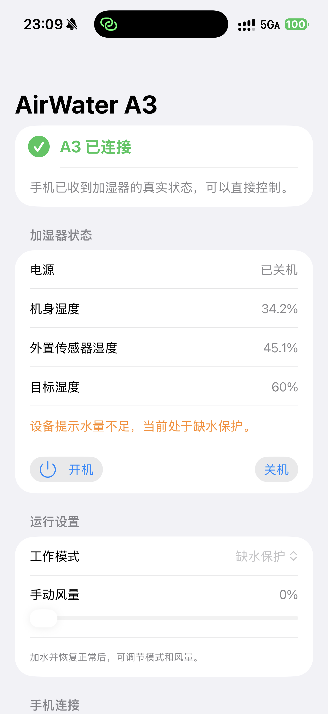

# AirWater A3

**面向受停服影响的 A3 用户与开发者的实验性 iPhone 本地控制器。** 这是源码项目，不提供可直接安装的 App：目前没有 App Store、TestFlight、IPA 或 Release 安装包。开源进展也不代表 App Store 审核通过。

[English](README.en.md) · [自行构建与签名](docs/BUILD.md) · [通信协议](docs/PROTOCOL.md) · [安全说明](SECURITY.md)

## App 能做什么

- **开关控制**：开机、关机，并读取设备回报确认状态。2026-09-27 在单台 A3 实测，也验证了 App 重启后重连。
- **查看设备状态**：显示电源、机身湿度、在线外置传感器湿度、目标湿度和缺水保护提示。目标湿度只读，不支持设置。
- **蓝牙配网**：查找附近的 A3，把手机热点名称和密码发送给选中的设备，也可更换热点配置。配网流程已实现，不同设备与固件兼容性待验证。
- **快捷指令重连**：首次配网并添加快捷指令后，点击「一键连接 A3」准备热点连接并返回控制页；也提供手动连接入口。2026-09-29 在一台 iPhone 17 Pro Max、iOS 27.0 上两次成功。
- **模式与风量**：界面提供手动、自动、睡眠模式和 0–100% 手动风量，缺水保护时禁用调节。**尚未完成正常运行验收。**
- **连接诊断**：查看连接事件、设备消息连接数，并手动请求当前状态，帮助排查连接问题。

这些结果是有限设备上的实验记录，不代表通用兼容或完整功能验收。其他 A3 固件、iPhone 型号与系统版本尚未验证。每轮控制约 10 分钟，控制需要 App 在前台运行；本项目不是后台常驻服务。

## 实机截图

<a href="docs/images/a3-connected.png"></a>

2026-09-29 的 iPhone 实机截图，点击可查看原尺寸。A3 当时已连接、保持关机并回报缺水保护，因此模式与风量控件呈灰色。这张图展示真实状态回读，不代表已验证正常加湿或风量调节。截图只移除了文件元数据，界面内容未修改。

## 工作方式

App 在个人热点开启前绑定 UDP 53，把 `i.airmx.cn` 与 `awm.airmx.cn` 解析到手机热点地址；A3 随后访问手机上的 HTTP 80 和 MQTT 1883 服务。首次使用还需通过蓝牙为 A3 配网，让它连接这个热点，并在 iPhone 上手动开启热点“最大兼容性”。

不需要 NAS、Home Assistant 或拆机。可选快捷指令用于重新连接：依次关闭热点、准备 A3 连接、打开热点、打开 A3 控制页，并把“准备 A3 连接”的输出传给最后一步。也可以手动创建这 4 个动作；生成签名快捷指令的说明见[构建与安装文档](docs/BUILD.md)。Mac 只用于编译和 USB 安装，保持原来的网络，不加入手机热点。

## 从源码开始

构建需要 Xcode 27（源码使用 iOS 27 SDK API）；工程部署目标为 iOS 16，但旧系统尚未实测。首次打开工程不会得到可直接安装的签名 App；自行签名和安装步骤见[构建与安装文档](docs/BUILD.md)。

```sh
git clone https://github.com/sudoHG/airwater-a3.git
cd airwater-a3
make generate
open AirwaterProbe.xcodeproj
```

## 已知边界与安全

- 本地 DNS 当前拒绝其他域名；不要让个人热点同时连接其他设备。内置 broker 只服务本地控制链路，不是公网或多租户服务。
- 退出 App 会断开控制连接，但不等于关闭 A3；离开前请按原厂说明确认设备状态。
- 不要绕过机器保护。清洁和水位处理请遵循原厂说明。
- 请勿提交 Wi-Fi 密码、设备 key、完整 Flash 镜像、pcap 或个人日志。安全问题的报告方式见 [SECURITY.md](SECURITY.md)。

协议与实现说明见[通信协议文档](docs/PROTOCOL.md)。欢迎提供可公开、无敏感数据的原厂应用分区、服务器地址或 OTA 线索；请先阅读安全说明，避免把凭证或可识别个人的信息放进 Issue、PR 或附件。

## 社区参考

以下是独立社区项目，仅作参考；本项目不代表与其作者或设备厂商有关联，也不包含原厂 APK 或固件：

- [dext0r/airmx](https://github.com/dext0r/airmx)
- [oladoga/AIRMX-Setup](https://github.com/oladoga/AIRMX-Setup)
- [denniszmq/airmx-a3-local-firmware](https://github.com/denniszmq/airmx-a3-local-firmware)

本仓库按 MIT 许可发布；第三方项目及其内容的许可和权利状态以各自仓库为准。
